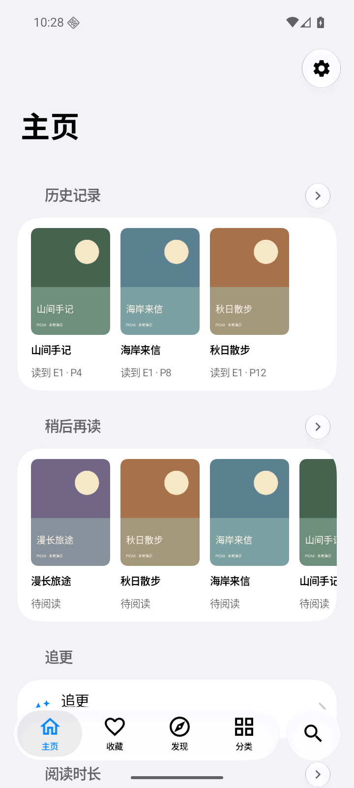
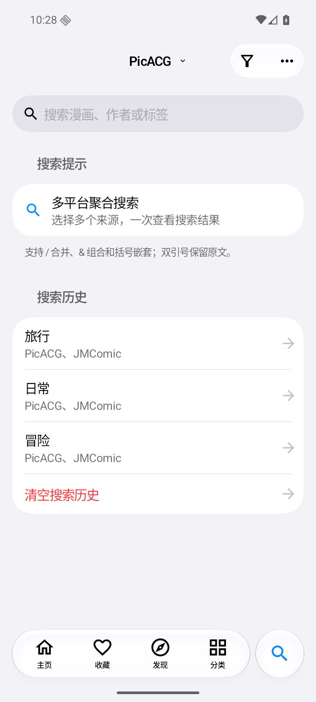
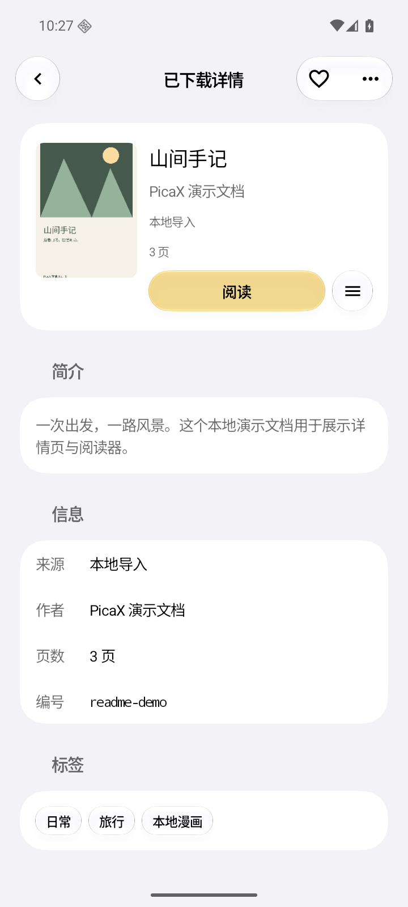
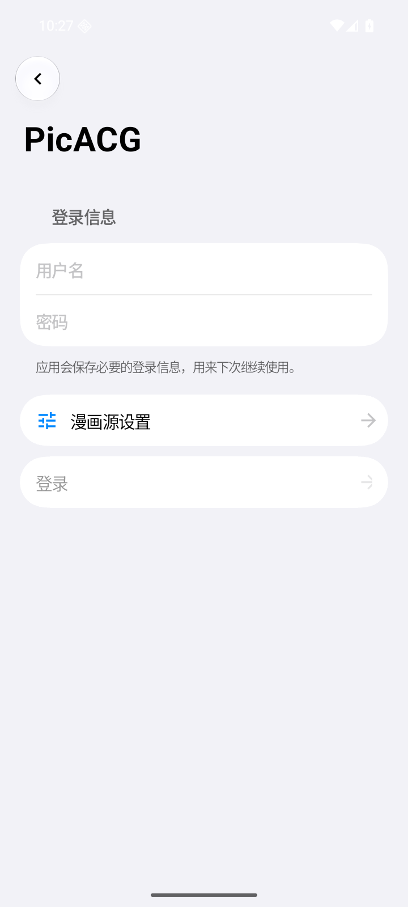
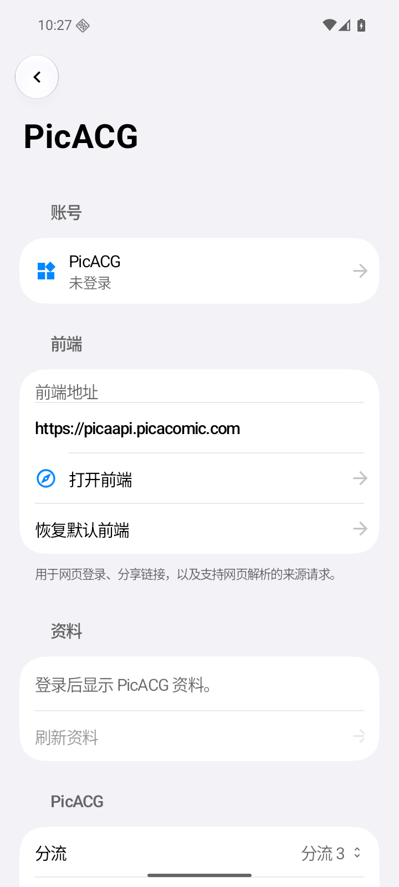
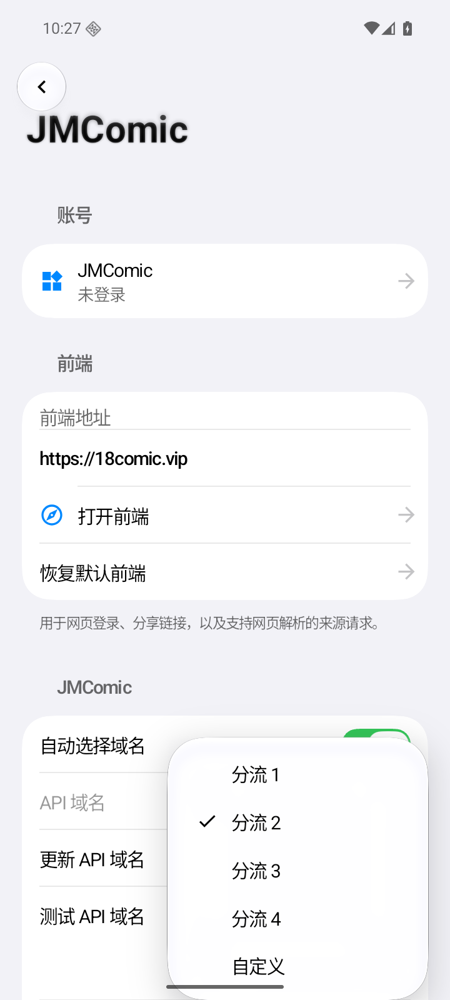

# PicaX for Android

[](https://github.com/youshen2/PicaX-Android/blob/master/LICENSE)
[](https://github.com/youshen2/PicaX-Android/releases)
[](https://github.com/youshen2/PicaX-Android/stargazers)

PicaX 是一个使用 Kotlin 构建的多漫画源阅读客户端，面向 Android 13+，使用液态玻璃设计规范。

[](https://github.com/youshen2/PicaX)
[](https://t.me/pica_x)

## 下载

<a href="https://github.com/youshen2/PicaX-Android/releases">
</a>

## 界面演示

截图来自 Android 端实际运行+本地演示用资源。

<p>
  
  
</p>
<p>
  
  
</p>
<p>
  
  
</p>

## 支持的漫画源

- PicACG
- JMComic
- NHentai
- E-Hentai / ExHentai
- Hitomi
- 绅士漫画

## 构建

需要 Git、Bash、Android SDK 37、NDK `27.1.12297006`、CMake `3.22.1`。工程的 Gradle daemon 配置使用 JDK 25；应用与 Glasmio 的 Java 字节码目标为 21。

```sh
git clone --recurse-submodules https://github.com/youshen2/PicaX-Android.git
cd PicaX-Android
./gradlew :app:assembleDebug
./gradlew :app:assembleRelease
./gradlew :app:testDebugUnitTest :app:lintDebug
```

## CI 与发布

GitHub Actions 在 main 推送、Pull Request、`v*` 标签和手动触发时执行测试、Lint 与 Release 打包，自动初始化 Glasmio submodule。标签版本通过签名校验后发布 APK；main 构建发送 Telegram 通知，正式版发送并置顶。

## 结构

- `model`：漫画、章节、账号、阅读及下载数据，搜索表达式解析。
- `data/source`：来源协议及共享 HTTP 传输。
- `data`：持久化、凭证、下载服务、图片处理、文档导入导出。
- `ui`：导航与主题；页面按功能目录组织。
- `vendor/glasmio`：Glasmio Git submodule，固定在 `bbba63b2f2584c4819bd88043332e241820d1ca0`。
- `patches/glasmio.patch`：PicaX 使用的玻璃渲染优化补丁。
- `scripts/prepare-glasmio.sh`：构建前提取固定提交并应用补丁，生成 `build/glasmio` 中的编译源码。

已有工作区先执行 `git submodule update --init --recursive`。Gradle 同步和构建会自动准备 Glasmio 源码。上游 submodule 保持干净，项目补丁由主仓库跟踪；生成目录由 `.gitignore` 排除。

## 特别鸣谢

[](https://github.com/ccbkv/PicaComic)

本项目参考的原始多源漫画客户端之一。

[](https://github.com/Pacalini/PicaComic)

原项目的原 fork，提供了可参考的跨平台功能与 README 信息。

[](https://github.com/tonquer/JMComic-qt)

JMComic 图片重组相关实现的重要参考。

[](https://github.com/EhTagTranslation/Database)

E-Hentai 标签中文翻译数据来源。

各漫画源网站及其社区维护者。

## 免责声明

本项目仅用于学习与个人使用，请在下载后 24 小时内删除。

应用中展示的漫画内容、账号系统和平台数据均来自对应漫画源，版权与服务条款归各平台及其权利方所有。请遵守当地法律法规和对应平台规则。

## 协议

本项目使用 Mozilla Public License 2.0 开源，详见 [LICENSE](LICENSE)。

Glasmio 与其依赖遵循各自的开源许可证，详见 `LICENSE` 与 `vendor/glasmio/THIRD_PARTY_NOTICES.md`。